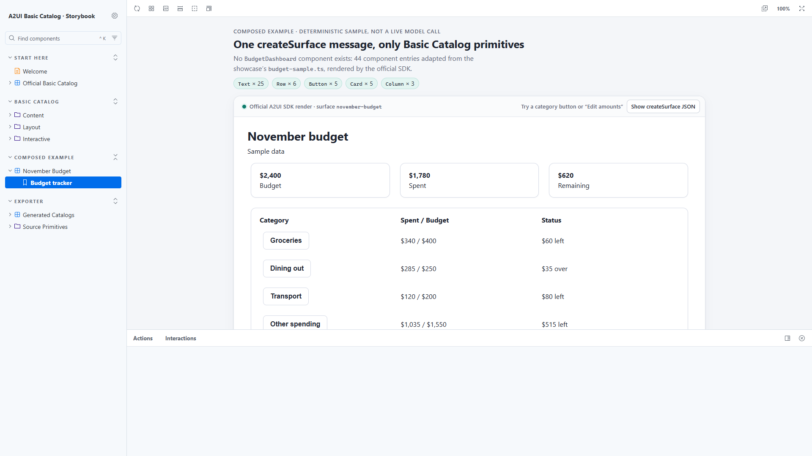

# A2UI Basic Catalog in Storybook

**Purpose:** show how a small set of **official A2UI primitives** can be composed by an agent into a complete
application (the November budget example from the capstone showcase), and how a team adds **its own** primitives
through our Storybook → A2UI exporter.

This project deliberately does **not** create `BudgetDashboard`, `StatCard`, `BudgetRow`, etc. The budget dashboard is
one A2UI `createSurface` message that composes `Text`, `Row`, `Column`, `Card`, `Button` and `TextField`, rendered by
the official A2UI React/web SDK.

Sources:
- Budget composition reference: [`budget-sample.ts`](https://github.com/o0avdi/a2ui-showcase-demo/blob/feature/personal-budget-demo/server/providers/budget-sample.ts)
- Official A2UI Basic Catalog: https://a2ui.org/concepts/catalogs/
- Capstone exporter: https://github.com/o0avdi/a2ui-storybook-exporter (pinned to `142dd7b`)



## Quick start

Node.js 24 recommended (minimum 22.12), npm, Git. Commands are written for PowerShell and work the same in bash.

```powershell
npm ci
npm run storybook          # http://localhost:6006
```

Sidebar order (built for a two-minute demo):

1. **Start Here / Welcome**: a short three-stop route and where the official components come from.
2. **Start Here / Official Basic Catalog**: component-focused explorer for the SDK's 18 components:
   property tables (type, required, default, description), highlighted JSON, copy buttons, the complete raw catalog.
3. **Basic Catalog / Content · Layout · Interactive**: 16 official components, each **rendered by the SDK** from a
   `createSurface` message, with purposeful variants, user-level controls, a live data-model readout and docs pages.
4. **Composed Example / November Budget**: the composition, with a side-by-side `createSurface` JSON view.
The **Exporter** stories are hidden by default using Storybook's tag filter, but remain in the project so the generated component manifest and CLI exporter workflow still work. The original exporter stories can be revealed through the sidebar filter if needed.

## How the Basic Catalog stories work (and what they are not)

- Every preview goes through one internal harness (`src/basic/BasicSurface.tsx`): the SDK's `MessageProcessor` with
  `STRICT_VALIDATION` and the official `basicCatalog`, rendered by `<A2uiSurface>` from `@a2ui/react`. No Basic Catalog
  widget is re-implemented. Styling uses only the SDK's documented `--a2ui-*` theme tokens (`src/styles.css`).
- **Controls are preview controls.** Each story's `build(args)` turns args into an A2UI message. Rows in the
  *A2UI properties* group map 1:1 to official schema properties: their descriptions, enum options and defaults are
  read from `basicCatalog.toJson()` (`src/basic/schema.ts`), so they cannot drift from the SDK. Rows in the
  *Preview setup* group only shape the demo (e.g. a Button's child `Text`, or the initial value behind a binding).
- The harness props (`message`, `onAction`) never appear in Controls or docs.
- **Actions:** SDK button events reach Storybook's native Actions panel through a `fn()` spy, logged as
  `onAction: ["save_budget", { name, surfaceId, sourceComponentId, timestamp, context }]`.
- **Live bindings:** interactive stories show an *SDK data model · live* panel fed by `dataModel.subscribe()`, so
  dragging a Slider or typing in a TextField visibly updates the bound value.
- Each docs page shows the live SDK render, the controls, **the A2UI message for the current controls**, and the
  **official schema table** for that component.
- SDK preview stories are tagged `!manifest`, so Storybook's components manifest (the exporter's input) contains only
  the real React source primitives.
- `Video` and `AudioPlayer` appear in the explorer only, because they need external media URLs.

## Exporter CLI (separate from the public Storybook tour)

The separate exporter CLI needs a **static** build (`storybook-static/manifests/components.json`), even while `npm run storybook`
is running. Prebuild before presenting so the live command is instant:

```powershell
# terminal 1
npm run storybook

# terminal 2
npm run demo:export        # build-storybook → catalog:basic → catalog:inspect → catalog:export → catalog:verify
```

**Clean live command** (one component, strict default policy, real CLI):

```powershell
Remove-Item -Recurse -Force a2ui-catalog/live -ErrorAction SilentlyContinue   # --out must be new or empty
npx storybook-a2ui export --storybook storybook-static --components ProgressIndicator `
  --catalog-id https://o0avdi.github.io/edis-storybook/catalogs/progress-indicator/v1 --out a2ui-catalog/live
```

Or `npm run catalog:export:one`, which clears its output folder, prints that exact command, and runs it.
Then show the JSON:

```powershell
npm run catalog:show -- ProgressIndicator     # one exported component schema
npm run catalog:show -- --extension           # complete multi-component exported catalog
npm run catalog:show -- --report              # exported / blocked summary
npm run catalog:show -- --official Button     # official SDK schema, labeled as such
```

### Artifacts and provenance

| File | Where the JSON actually came from |
| --- | --- |
| `a2ui-catalog/basic/catalog.json` | **Official SDK** catalog, serialized by `basicCatalog.toJson()`. Not generated by our exporter. |
| `storybook-static/manifests/components.json` | **Storybook** (`features.componentsManifest: true`). Lists `StatusBadge`, `MetricLabel`, `ProgressIndicator`. |
| `a2ui-catalog/extension/catalog.json` + `export-report.json` | **Our exporter**, 3 components (`--components StatusBadge,MetricLabel,ProgressIndicator`). |
| `a2ui-catalog/progress-indicator/catalog.json` + `export-report.json` | **Our exporter**, one component. |
| `catalog-snapshots/**` | **Pre-generated** copies of the above, committed as an offline fallback and shown in Storybook. See `catalog-snapshots/README.md`. |

`npm run catalog:verify` checks that:

- the official catalog is intact;
- each export ran with the strict `unmappedEvents: fail` policy and exported exactly the requested components;
- each catalog re-validates against the pinned A2UI v1.0 schemas;
- sample component bodies are accepted and broken ones are rejected;
- no exported name collides with an official component;
- the committed snapshots still match a fresh export.

### Why not run the exporter on the Basic Catalog?

The official Basic Catalog already exists as a rich schema describing children, actions, bindings, validators, arrays
and functions. The SDK's Basic components are web-rendered implementations, not local React source components with
flat Storybook-documented props. Storybook can **display** them through the SDK harness, but its docgen does not hold
their authoritative contracts. The exporter (prototype v0.1) converts Storybook manifests of **source components** and
intentionally blocks events, children, arrays and objects. Re-exporting the Basic Catalog from Storybook props would
lose protocol semantics and would be misleading.

```
Official A2UI Basic Catalog (already provided by SDK)
           +
Agent chooses and arranges primitives in A2UI JSON
           ↓
Official A2UI renderer → budget tracker

For new / company-specific components:
React primitive → Storybook documentation + manifest
           ↓
Our exporter → validated additional A2UI catalog definition
           ↓
Register renderer implementation before agents can use it
```

The exported primitives are **not** registered as A2UI renderer components here; this project stops at a validated
schema.

**Known exporter finding:** exported component schemas use `additionalProperties: false`, which rejects the envelope
`id` when a full wire component is validated against the pinned A2UI v1.0 envelope schema. The exporter was not modified.
See [`docs/EXPORTER_FINDINGS.md`](docs/EXPORTER_FINDINGS.md) and `node scripts/repro-envelope-id.mjs`.

## Commands

| Command | What it does |
| --- | --- |
| `npm run storybook` | Dev server on port 6006 |
| `npm run build-storybook` | Static build with `index.json` and `manifests/components.json` |
| `npm run typecheck` | `tsc --noEmit` over `src`, `.storybook`, `tests` |
| `npm run catalog:basic` | Writes the official catalog from the installed SDK |
| `npm run catalog:inspect` | `storybook-a2ui inspect`: exportable vs. blocked, with reasons |
| `npm run catalog:export` | Multi-component and one-component exports (prints each real command) |
| `npm run catalog:export:one` | One-component export only |
| `npm run catalog:verify` | Provenance, validation and snapshot checks (see above) |
| `npm run catalog:show -- …` | Presenter JSON viewer, labeled by provenance |
| `npm run catalog:snapshot` | Refreshes `catalog-snapshots/` from `a2ui-catalog/` |
| `npm run demo:export` | build → basic → inspect → export → verify |
| `npm run test:e2e` | Playwright tests against the static build (run `build-storybook` first) |
| `npm run screenshots` | Same tests, also writing `docs/screenshots/after/` |

End-to-end tests use the locally installed Google Chrome (no browser download). On CI they use Playwright's Chromium
(`npx playwright install --with-deps chromium`). To test a running dev server instead, set the environment variable
first: `$env:STORYBOOK_URL='http://localhost:6006'; npm run test:e2e`.

## Verification

Results from the last local run (Windows 11, Node 24.20.0) are listed in [`docs/VERIFICATION.md`](docs/VERIFICATION.md).
Screenshots: [`docs/screenshots/before/`](docs/screenshots/before) (original) and
[`docs/screenshots/after/`](docs/screenshots/after) (generated by `npm run screenshots`).

## Project files

- `src/basic/BasicSurface.tsx`: internal SDK harness (MessageProcessor + `<A2uiSurface>`, live data-model readout)
- `src/basic/schema.ts`: read-only helpers over `basicCatalog.toJson()` (property rows, enums, type labels)
- `src/basic/storyKit.tsx`, `SdkDocsPage.tsx`: shared story plumbing and the Basic Catalog docs page
- `src/basic/BasicCatalogExplorer.tsx`, `SchemaTable.tsx`, `JsonView.tsx`: official schema explorer
- `src/stories/basic/*.stories.tsx`: one story file per official component
- `src/examples/budget.ts`: deterministic composition adapted from the showcase (differences listed at the top)
- `src/examples/BudgetSurface.tsx`: presentation shell; relays SDK actions to the sample logic and to Actions
- `src/extensions/*.tsx`: the exportable React primitives (`StatusBadge`, `MetricLabel`, `ProgressIndicator`)
- `src/exporter/*`: Storybook pages for exporter output (pre-generated snapshots)
- `scripts/`: catalog sync, export wrapper, verify, snapshot, viewer, static server, finding reproducer
- `tests/e2e/`: Playwright tests (Actions, controls, bindings, budget flow, explorer, exporter, all-stories smoke)

## Limitations

- The budget screen is deterministic sample logic, not a live LLM call; live prompting happens in the separate
  showcase app.
- `Video` and `AudioPlayer` have no preview story (they need external media).
- Storybook pages show the **pre-generated** exporter snapshot; fresh output is in `a2ui-catalog/` and the CLI.
- The SDK renders TextField labels without a programmatic association to the input (see `docs/EXPORTER_FINDINGS.md`, section 2).
